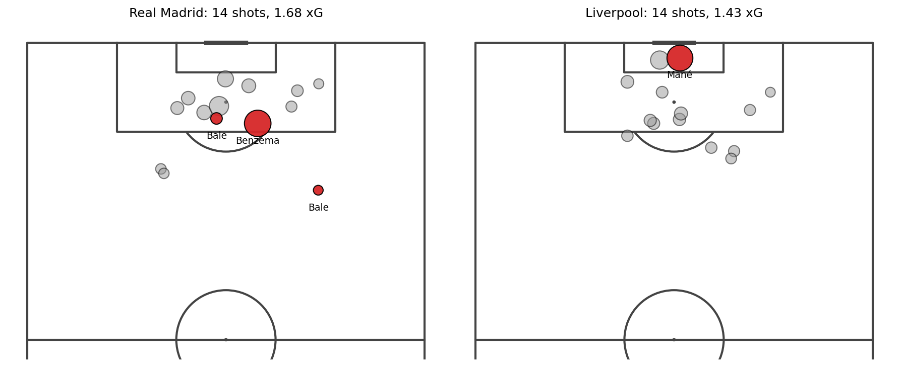
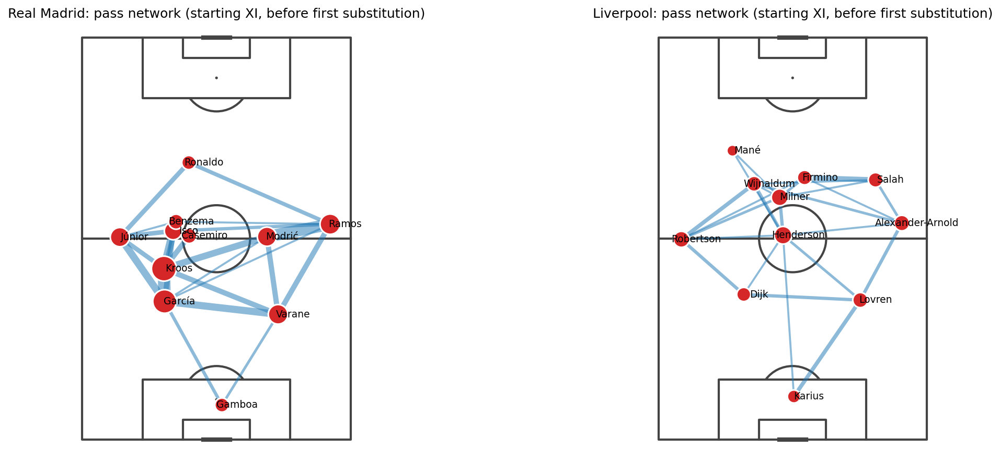
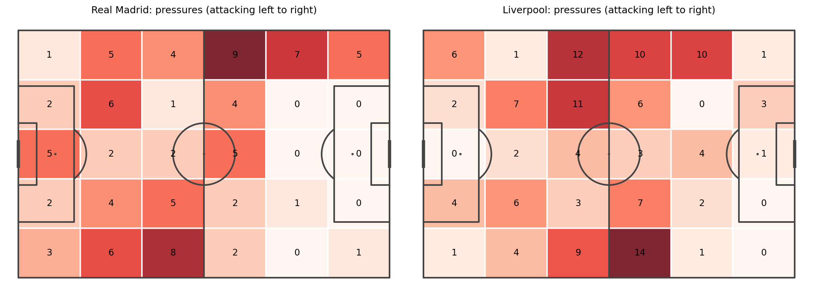

# Real Madrid 3–1 Liverpool: a single-match analysis

**2018 UEFA Champions League final · Kyiv · 26 May 2018**

> **Question:** Real Madrid won 3–1, but did they create better chances than Liverpool, or did finishing decide the match?



## Key findings

1. **The chances were almost equal.** Both teams took 14 shots. Real Madrid generated 1.68 xG and Liverpool 1.43 xG.
2. **Finishing decided the match.** Real Madrid scored 3 goals from 1.68 xG (+1.32 over expectation), while Liverpool scored 1 from 1.43 xG (−0.43). Two of Madrid's goals, both by Gareth Bale (63' and 82'), were worth only about 0.05 xG combined.
3. **Control of the ball did not mean more chances.** Real Madrid made 65% of the passes with 88.6% accuracy (Liverpool: 35% and 73.9%), but the shot count and xG stayed level. Liverpool made more pressures (134 vs 92).

## Match at a glance

| | Shots | On target | Goals | xG | Passes | Pass accuracy | Pass share |
|---|---|---|---|---|---|---|---|
| Real Madrid | 14 | 6 | 3 | 1.68 | 673 | 88.6% | 65.2% |
| Liverpool | 14 | 3 | 1 | 1.43 | 360 | 73.9% | 34.8% |

*Pass share is used as a possession proxy (StatsBomb open data has no time-based possession). Regular time only; no extra time was played.*

## Visuals

**Pass networks** (all players, until end of match)



- Real Madrid's hub is Toni Kroos (84 passes), and the busiest link is Sergio Ramos ↔ Raphael Varan (33 passes).
- Liverpool's busiest link is Andrew Robertson ↔ Virgil van Dijk (13 passes), and Jordan Henderson has the most passes (39).

**Pressing zones** (where each team applied pressure; attacking upward)



## Data

[StatsBomb Open Data](https://github.com/statsbomb/open-data), match ID `18245`, accessed with [`statsbombpy`](https://github.com/statsbomb/statsbombpy). Data © StatsBomb, used under their open data license. Credit StatsBomb in anything derived from this project.

## Method

1. Load all events of the match and split `[x, y]` locations into numeric columns (`src/data.py`).
2. Compute per-team shot, xG and passing summaries, and a cumulative xG timeline (`src/features.py`).
3. Build pass networks: node = player (average pass location, size = completed passes), edge = completed passes between two players, shown above a minimum threshold.
4. Plot shot maps, pass networks and pressing heatmaps with `mplsoccer` (`src/viz.py`).

## Project structure

```
├── data/            raw and processed data (git-ignored)
├── notebooks/       01 loading → 02 EDA → 03 analysis
├── src/             reusable functions (data, features, viz)
├── tests/           unit tests
└── outputs/figures/ images used in this README
```

## Reproduce

```bash
python -m venv .venv && source .venv/bin/activate
pip install -r requirements.txt
jupyter notebook notebooks/
```

## Limitations

- **One match is a small sample.** Over- or under-performing xG over a single game is largely luck, so this says what happened in this match, not how good either team is.
- **Pass share is not possession.** It counts passes, not time on the ball.
- **Pressure counts depend on the opponent having the ball.** Real Madrid had more of the ball, so Liverpool had more opportunities to press.

## Author

Yassine ELAZRI · [LinkedIn](https://www.linkedin.com/in/moyassine-el/) · [GitHub](#)
